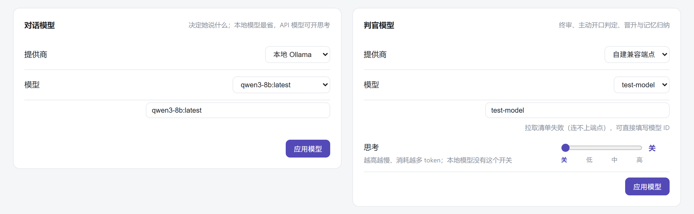
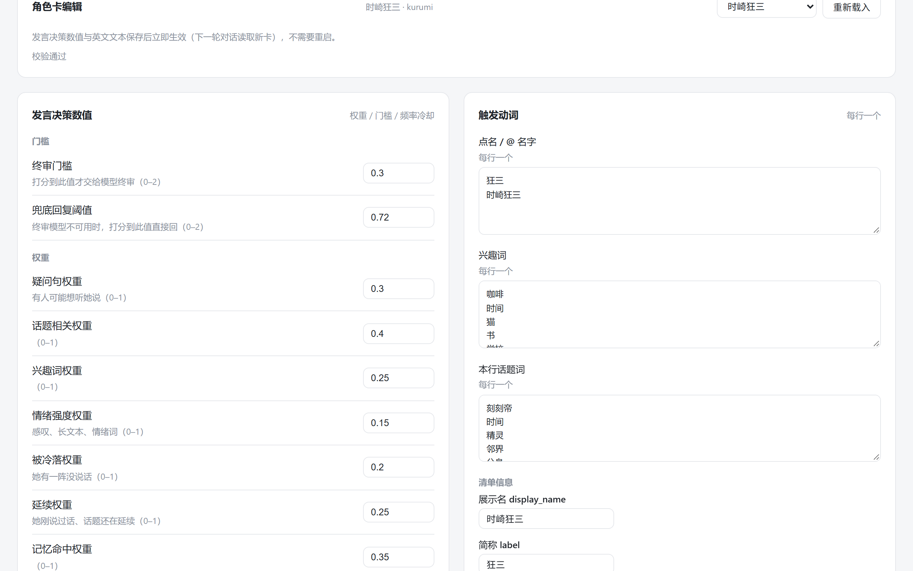
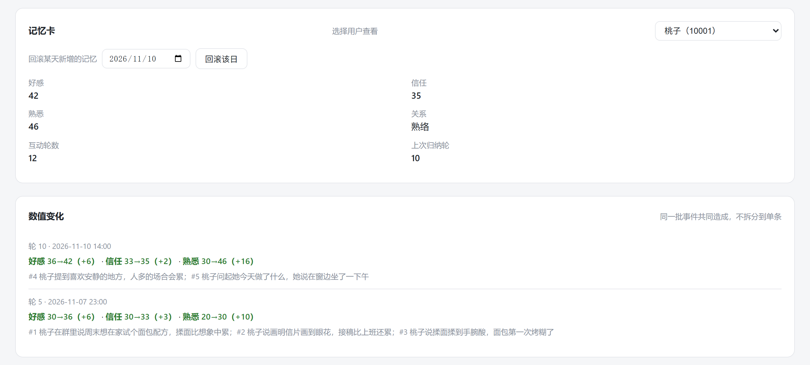
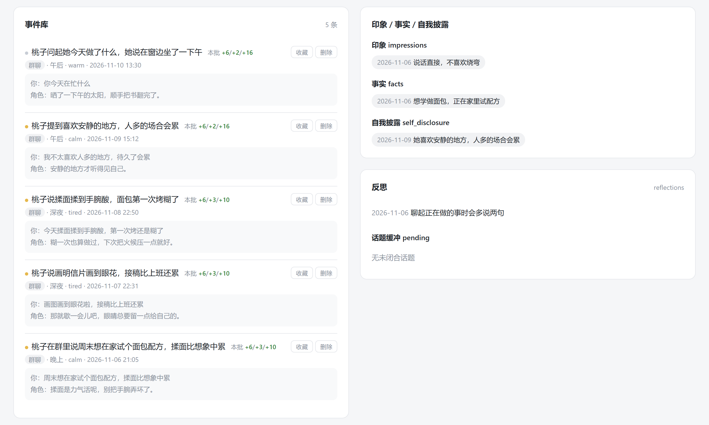

<div align="center">


# nurture-a-life

以何物培育一颗心 · 你跟她说的每句话，都在汇成她的心。

[](requirements.txt)
[](https://github.com/botuniverse/onebot-11)
[](requirements.txt)
[](LICENSE)
[](#更新记录)

[这是什么](#这是什么) · [快速开始](#快速开始) · [常用指令](#常用指令) · [先看行为](#不接-qq-先看行为) · [配置](#配置) · [常见问题](#常见问题) · [限制](#限制与已知问题)

</div>

---

她的起点写在 `prompts/personas/` 下的一个目录里。设定、说话方式、关系档位与发言判断都写在其中。仓库带了两张可以直接跑起来的示例卡，一张虚构角色用于离线测试，一张是《约会大作战》的时崎狂三。换成别的角色就是换一张卡，面板页头的角色下拉和群里的 `/character` 都能切过去。

她往后怎么变，由你们怎么相处决定。你把自己的事讲给她，她也把当天的事讲给你，聊过的话先落成一条条事件，攒够了归纳进记忆卡，好感、信任与熟悉三项数值决定她把你算作陌生、相识、熟络、亲密还是倾心，说话方式再按数值取到卡里对应的档位。她存下的不是你的资料，是你们之间说过什么，所以在保持人设的同时，她会像认识你很久的人那样跟你说话。

日常里她跑在你自己的电脑上，接在同一个 QQ 群中。你 @ 她或者点到她的名字，她会回应；没人叫她的时候她也在听，觉得这件事与她有关才开口，不会见消息就插话。她有属于自己的天气、街景、着装和日程，也会跨天写日记。她惦记着几件事，想起来会主动问你一句，就像你也会找她那样。

她记得的一切都以明文 JSON 留在本机，没有数据库也没有云同步，删掉 `state/` 就回到第一天。她的设定、你们之间说过什么、她自己那些天气和日记，都是这台机器上看得见的文件，读、改、清掉都由你决定。下面逐项写清每件事能做到什么、在哪里改。

## 这是什么

这是一个自托管的 QQ 角色运行时。消息经 NapCat 的 OneBot v11 反向 WebSocket 进来，每一轮先判定她是否开口，再由对话模型生成回复，说完把这轮对话结算进长期记忆。本项目要解决的不是让模型更会说话，而是让一个由角色卡定义的虚构人格长期存在于你的 QQ 里，成长在一次次的对话中攒出来，设定与记忆都不随模型更换而归零。

- **角色卡驱动**。设定、关系分档、说话方式、发言判断全写在一张卡里，换角色就是换卡，仓库已带两张示例卡。
- **两个模型分工**。台词由对话模型写，是否开口、话题在哪里收尾、这一轮归纳成什么记忆由判官模型判定，后者不参与说话。
- **三层记忆**。聊过的事先存成一条条事件，攒够了再归纳成记忆卡，卡片能从事件重算，让她在保持人设的同时记得和你发生过的故事。
- **按关系换分寸**。好感、信任、熟悉各自分档，卡里为每一档写了她面对这一档的人时的说法与分寸，同一件事讲给陌生人和讲给亲近的人不一样。
- **群里会自己判断**。被 @ 或点到她的名直接接话，没人叫她时她也在听，会挑自己感兴趣的或者和你相关的话去接。
- **有自己的生活**。每天生成一次当天的天气、街景、着装和日程，跨天写日记、攒几件惦记的事，私聊里会挑一件主动开口。
- **全程本地**。状态都是明文 JSON，没有数据库、没有云同步，删掉 `state/` 就回到第一天。
- **语音与出图可选**。接你自己部署的 GPT-SoVITS 与 ComfyUI，不装也能正常聊天。

## 快速开始

需要 Windows、Python 3.13、一个能对话的模型（本机 Ollama 或云端 OpenAI 兼容服务均可），以及一个 NapCat 实例。

### 1. 装依赖（只做一次）

这两条要在项目目录里跑，也就是 `start.bat` 所在的那一层，因为 `.venv` 会建在当前目录。运行时的 `state/`、`logs/` 与 `local_api.key` 同样落在项目目录下，整个目录搬到别的盘时它们跟着走，只有 `.venv` 需要重建一次。`pip` 的下载缓存默认放在 `%LOCALAPPDATA%\pip`，不想让它占 C 盘就在命令后面加 `--no-cache-dir`。

```bat
python -m venv .venv
.venv\Scripts\pip install -r requirements.txt
```

运行依赖只有一个 `websockets`，开发工具在 `requirements-dev.txt`。

### 2. 双击 `start.bat`

第一次运行会先问 4 组问题，分别是机器人 QQ、管理员 QQ、只守的群号、模型端点与模型名，端点需要 key 时接着再问一次，写进项目根的 `local_api.key`。本机没找到 Ollama 时会再问一次是否安装，装到哪个目录由你决定，默认给的路径不含连字符，自己填的也要注意这一条。答案落在 `state/setup.json`，随后连一次端点并打印结果。想重答一遍就运行下面这条。

```bat
.venv\Scripts\python.exe scripts\setup.py --force
```

之后每次启动只需双击 `start.bat`。它会依次拉起 Ollama、NapCat、桥接、进程守护与管理面板，并打开面板和 NapCat 扫码页。

### 3. 登录 NapCat 并接上桥接

NapCat 首次登录需要扫码。登录后打开它的 WebUI `http://127.0.0.1:6099`，在**网络配置**里新增一个 **WebSocket 客户端**，地址填写下面这一行。

```
ws://127.0.0.1:6700/onebot/v11/ws
```

到这里她就能收发消息了。首次跑起来的是示例人格「苏禾」（`character`），换成狂三可以在面板页头的角色下拉里选 `kurumi`，或在群里发 `/character kurumi`。管理面板在 `http://127.0.0.1:6780/`，token 在启动日志里输出，也会落盘到 `state/admin_token`。

Ollama 与 NapCat 的位置会自动找，顺序是环境变量、`state/setup.json` 里记下的目录、项目内的 `tools\Ollama` 与 `tools\NapCat\Shell`、PATH 与各固定盘上的常见目录。都没找到时可以运行 `scripts\install_ollama.py` 把 Ollama 装进项目，它同样会先问装到哪个目录；官方下载走的是 GitHub 的发布包，连不上时用 `--url` 指一个镜像。也可以直接用 `NAL_OLLAMA_HOME` / `NAL_NAPCAT_HOME` 指定，这两个变量支持相对路径，按项目根目录展开。

## 预览

面板分六个页签，分别是配置、角色卡、记忆明细、群状态、语音与 CG 绘图。角色在页头下拉里切换，改完即时生效。

配置页把对话模型与判官模型各做成一张卡。提供商的下拉只列本机配好了的那几个，没配 key 的云端选项不会出现，最常见的是本机 Ollama 和初始化向导里填的那个 OpenAI 兼容端点，换端点改 `LOCAL_API_BASE_URL` 或 `state/setup.json`，任何兼容服务都从这一格接进来。选定提供商后从拉到的模型清单里挑，清单拉不到也可以直接填模型 ID；选了自建端点或云端还多一条思考滑块，本机 Ollama 没有这一挡。


<p align="center"><sub><b>配置</b>。对话模型走本机 Ollama，判官模型接自建端点，清单拉不到时可直接填模型 ID</sub></p>

角色卡页选一张卡来编辑，能改的是发言门的门槛与权重、冷却、触发动词、英文角色文本与每日作息。这些数值随角色走，不在配置页。


<p align="center"><sub><b>角色卡</b>。狂三卡的终审门槛、兜底回复阈值与各权重，右列是触发动词与兴趣词</sub></p>


<p align="center"><sub><b>记忆与数值</b>。示例用户桃子（10001），三个数值各是多少、每次归纳涨了多少</sub></p>


<p align="center"><sub><b>事件</b>。每条事件的原话、场景、时间与对应的数值贡献，可收藏或删除</sub></p>

## 常用指令

群聊和私聊都能用，作用范围只到自己。

| 指令 | 作用 | 谁能用 |
|---|---|---|
| `/relation` | 她跟你的关系到哪一档 | 所有人 |
| `/remember` | 她记得的你的最近几件事 | 所有人 |
| `/forget` | 清空她关于你的记忆，旧数据先归档 | 所有人 |
| `/ <内容>` | OOC 旁注，只有你自己看得见，不进上下文也不回复 | 所有人 |
| `/help` | 当前角色实际开启的指令列表 | 所有人 |
| `/diag` | 链路诊断，看队列与端点状态 | 所有人 |
| `/tts <内容>` | 这一句带语音；`/tts on` 与 `/tts off` 控制本会话常开；`/tts daily` 与 `/tts battle` 换语气 | 所有人，需接语音服务 |
| `/cg` | 用本地 ComfyUI 画一张 CG | 所有人，需接出图服务 |
| `/cg new` · `/cg <内容>` | 强制重画 · 追加画面要求 | 管理员 |
| `/status` | 队列、冷却、活跃时段 | 管理员 |
| `/topic` | 让她现在主动找个话题 | 管理员，且在私聊白名单内 |
| `/group on` 与 `/group off` | 本群开关，关掉后本群消息一律不接 | 管理员，仅群里 |
| `/group set <key> <value>` · `/group unset <key>\|all` | 只给本群改参数（历史条数、单条字数、成员摘要、主动阈值、工具开关）；`/group status` 看生效值，`/group settings` 看覆盖项，`/group list` 列出已知群 | 管理员，仅群里 |
| `/character <id>` | 切换当前角色 | 管理员 |

`/help` 只列当前角色开启的能力，语音或出图没接时对应指令不会出现在列表里。

## 不接 QQ 先看行为

没有 QQ、没有模型，也能验证整套记忆与群聊逻辑，命令如下。

```bat
.venv\Scripts\python.exe scripts\sim_group.py --root .probe_tmp\sim --rounds 1
```

它构造 8 位群友轮流发言，每轮重新拼一次 system，记忆相关代码走真实路径，只把生成环节换成固定回复。产物写到 `--root` 指定的目录，不碰线上的 `state/`，输出如下。

```text
[01] 群友A：最近忙到不行，我工位在走廊最里头，一坐一整天。
     角色：（结构测试回复）
     system 2222 字 / 120 ms / 记忆动作=closed

=== 断言 ===
[PASS] A1 被回过话的人都有记忆文件
[PASS] A1 记忆不串味（无他人隐私）
[PASS] A2 成员卡昵称正确
[PASS] A3 成员注入 ≤ 4 人
[PASS] A4 被提到的人已注入成员块
[PASS] A5 system 峰值 2275 字 < 8000

断言：8/8 通过
```

上面是某次运行的原样输出，字数和耗时跟机器、历史长度有关，换个环境不会一样。每轮的 system 原文落在 `.probe_tmp\sim\systems\`，可以逐条看她这一轮被告知了什么。下面几条检查同样不需要 QQ 和模型。

```bat
.venv\Scripts\python.exe scripts\run_offline.py scripts\qq_bridge.py --selftest
.venv\Scripts\python.exe scripts\runtime_config.py --check
.venv\Scripts\python.exe scripts\card_source.py --check
```

## 可选增强

只有两项功能需要额外服务，按需安装，不装不影响文字对话。

| 想要的效果 | 需要准备 | 打开方式 |
|---|---|---|
| 语音 | [GPT-SoVITS](https://github.com/RVC-Boss/GPT-SoVITS) 的 `api_v2.py`，加一段你自己录的 3-10 秒干净人声 | 设 `NAL_TTS_URL`、`NAL_TTS_REF_AUDIO`、`NAL_TTS_PROMPT_TEXT` |
| 出图 | [ComfyUI](https://github.com/comfyanonymous/ComfyUI)，加一个你自己准备的 checkpoint | 设 `NAL_COMFY_URL`，工作流默认 `assets\cg\workflows\sd15_t2i.json` |

缺少哪一项，对应指令会明确回一句未启用，其余功能照常。

## 怎么运作

```
消息进来 → 发言决策（L1 打分，必要时判官终审）→ 拼 system → 对话模型回复 → 事后结算记忆
```

| 模型 | 干什么 |
|---|---|
| 对话模型 | 按拼好的 system 出这一轮回复；每天生成一次场景、着装和日程；跨天写日记和好奇清单 |
| 判官模型 | 是否开口、话题在哪里收尾、这轮对话归纳成什么记忆、私聊之后是否改动今天的日程 |

有三件事值得先知道。

- 记忆分三层，事件不可变，记忆卡能从事件重算，归纳出错可以修。
- 发言决策分两级，先用规则和向量打分挡住大部分消息，越过候选线的才问模型，群里刷屏不会把串行队列打满。
- 群聊、私聊、离线模拟共用同一个拼装函数，测试里看到的行为就是线上行为。

模块图、system 块序、注入示例、全部可调参数及出处见 [docs/architecture.md](docs/architecture.md)。

## 配置

优先级从高到低是**环境变量 > `state/setup.json` > 代码默认值**。完整清单见 [.env.example](.env.example)。

| 变量 | 作用 |
|---|---|
| `NAL_SELF_ID`、`NAL_GROUP_ID`、`NAL_ADMIN_ID` | 机器人 QQ、只守的群（留空 = 所有群）、管理员 |
| `LOCAL_API_BASE_URL` | 自建 OpenAI 兼容服务的端点，即向导询问的那一项 |
| `NAL_MODEL` | 这个端点上的模型名 |
| `QWEN_API_KEY` | 使用千问云端服务时需要提供，也可以写进项目根 `qwen.key`（已 gitignore） |
| `NAL_ADMIN_TOKEN` | 面板 token，不设则首次启动生成并落盘 `state/admin_token` |
| `NAL_OLLAMA_HOME`、`NAL_NAPCAT_HOME` | 外部程序位置，默认自动探测，探测不到时再手动指定 |
| `NAL_VRAM_GB` | 手动指定显存档位，否则按 `nvidia-smi` 探测 |
| `NAL_EMBED` | 换 embedding 模型 |

面板「配置」页改的是同一批设置，写入 `state/runtime_config.json` 并即时生效，不需要重启；对话与判官用哪个模型、开几档思考也在这一页的模型卡里选。发言阈值这类按角色调的参数不在这里，它们写在角色卡的 `gate` 里，气泡上限写在 `bubble_limit` 里，面板「角色卡」页就是编辑这两处的地方，改完下一轮生效。

## 数据与隐私

状态都是明文 JSON，集中在 `state/`，已在 `.gitignore` 里，结构如下。

```
state/setup.json                     首次向导的答案
state/runtime_config.json            面板改的运行设置
state/personas/<id>/daily_scene.json 当天的天气、街景、着装、日程
state/personas/<id>/self_state.json  她的日程、日记、好奇清单
state/personas/<id>/users/<uid>/     每个人的记忆卡、事件库、数值历史与备份
state/members/<uid>/member.json      群成员卡，跨角色共用
```

- 记忆卡每天自动快照，另有滚动备份，能回滚到某一天。
- `/forget` 清空某个人的记忆前，会先把旧数据归档到 `.../users/<uid>/backups/`。
- 想彻底重来，可以停掉进程，删掉整个 `state/`，重跑 `start.bat`。
- 密钥只从环境变量或 `*.key` 文件读取，两者都不入库。

## 常见问题

**她完全不说话**。先跑 `/diag`，再依次确认 NapCat 的 WebSocket 客户端地址是否写成 `ws://127.0.0.1:6700/onebot/v11/ws`、群开关是否开着、当前时间是否在活跃时段（默认 9:00-23:00）内。

**回复很慢或超时**。自建端点冷启动要把整个模型载入显存，第一条可能等几分钟，超时因此设成 300 秒。反复超时时要检查服务是否真的在运行、显存是否足够。

**401 或鉴权失败**。检查环境变量里的 key 与 `QWEN_BASE_URL` / `LOCAL_API_BASE_URL` 是否属于同一个服务，两者必须配套才能通。

**她在群里话太多或太安静**。改角色卡 `persona.json` 的 `gate` 里的候选线 `consider_at`、群冷却 `group_cooldown` 与每分钟上限 `max_per_min`，面板「角色卡」页改的就是这几项。不同模型的打分分布差别明显，换模型后先跑 `scripts\group_gate.py` 看 L1 放行比例，再跑 `scripts\gate_threshold_calibrate.py --offline` 拿建议阈值（不花钱，只算分）。

**记错了事**。打开面板「记忆明细」，条目可以直接删改，事件原文始终保留，归纳错了能重算。

## 开发与测试

```bat
.venv\Scripts\pip install -r requirements-dev.txt
.venv\Scripts\python.exe scripts\sim_group.py --root .probe_tmp\sim
.venv\Scripts\python.exe scripts\panel_check.py
.venv\Scripts\python.exe -m pytest
.venv\Scripts\python.exe -m ruff check scripts
```

`run_offline.py` 会装一个写盘保护钩子，任何测试试图写线上 `state/` 都会直接报错，所以可以放心对着真实数据跑回归。`sim_group` 自己要在 `state/` 下建产物目录，跑的时候用 `--root` 指到别处。

`panel_check.py` 对着面板文件做静态核对，要求配置层声明的每一项在面板里都有对应控件（标了 `hidden` 的项要有承载它的那块专门 UI），面板里引用的 key 不能已经从配置层删掉，路由、元素 id、模型提供商三边要对得上。改完配置层或面板跑一次，就能挡住「后端加了字段、面板没有开关」这类漂移。

## 角色卡

仓库带两张卡，放在 `prompts/personas/` 下。

- `character/` 是虚构的示例人格「苏禾」，离线测试用它。
- `kurumi/` 是《约会大作战》时崎狂三的同人示例卡，演示完整的 `gate` 权重、关系分档、背景条目与 CG 身份层写法。

想换成自己的角色，照 [prompts/personas/README.md](prompts/personas/README.md) 的格式新建一个目录，面板页头的角色下拉和 `/character` 都能切过去。目录里缺少某个可选文件时对应能力自动关闭，例如没有 `tts.json` 就没有语音。

## 限制与已知问题

- 只在 Windows 与 Python 3.13 上验证过。Linux 理论上能跑，但启动脚本按 Windows 写的，没有测试。
- 记忆由模型归纳，会把条目归错类或漏记。数据是明文 JSON，可以查看、可以手改，也有每日快照可回滚。
- 仓库不含声线与模型权重。音色归属角色版权方，只能接你自己部署的服务。
- QQ 侧使用 NapCat 的非官方协议，与官方无关，账号风险自行评估。
- 活跃时段与发言阈值按示例角色调定，换模型或换群氛围后需要重校。

## 更新记录

### v0.2.0（2026-11-11）

- 群参数可按群覆盖：群聊开关、主动开话题阈值、上下文预算（历史条数 / 单条字数 / 成员摘要人数）、工具开关，未覆盖的项继续跟随全局。
- 新增 `/group status`、`/group settings`、`/group set`、`/group unset`、`/group copy`、`/group list`；关闭本群后管理员仍可用 `/group on` 叫回来。
- 面板「群状态」页新增「群参数」卡片，可查看本群生效值、只写改过的项、一键改回跟随全局；新增 `/api/groups` 与 `/api/group-settings`。
- 群聊历史条数与单条字数纳入同一套按群预算，`rp_core.build_messages` / `format_group_turns` 支持逐群上限。
- 回归：群参数 68 项、桥接自测 70 项、导入冒烟与 ruff 全过。

### v0.1.0（2026-11-10）

- 首个发布版：角色卡、记忆归纳、群聊发言决策、日常生成、面板与离线模拟。

## 许可

代码以 [MIT](LICENSE) 发布。仓库不含第三方源码和模型权重，只通过 HTTP 调用你自己安装的服务；NapCat、Ollama、GPT-SoVITS、ComfyUI 的许可与归属见 [THIRD_PARTY.md](THIRD_PARTY.md)。

> [!IMPORTANT]
> 非官方同人项目，与任何作品、公司或角色官方无关联、无授权关系。仓库不含原作语料、角色语音和官方立绘；同人卡只作格式示例，角色版权归权利人，不适用本仓库的 MIT 许可。
