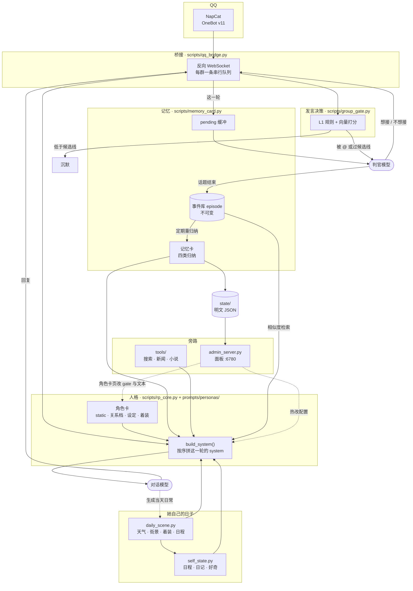

# 架构与调参

本文放实现细节与参数表。README 只讲怎么用，这里讲为什么这样设计和去哪里改。
所有数值以代码为准，本文标注了出处。

## 模块与数据流



一次消息的实际路径如下。

1. NapCat 推事件，桥接解析、去重、判断是否指令。
2. `group_gate` 先算 L1 分数，低于候选线直接沉默，不花模型调用。
3. 越过候选线的交给判官终审，由它决定是否开口。
4. `rp_core.build_system()` 按固定块序拼 system，对话模型出这一轮回复。
5. 回复发出后，记忆环节才介入，依次进缓冲、判边界、必要时归纳进记忆卡。

记忆环节失败只推迟话题闭合，不影响本轮回复。文字对话、群聊、离线模拟
（`sim_group.py`）共用同一个 `build_system()`。

## system 块序

出处是 `scripts/rp_core.py` 的 `_build_system_inner()`，按 `add()` 调用顺序。

| 序 | 块名 | 内容 | 是否常驻 |
|---|---|---|---|
| 0 | `card static` | 角色卡的固定设定、说话方式、规则 | 常驻，约 4.3k 字符 |
| 1 | `identity` | 这一轮在跟谁说话（对方画像） | 按发言人变化 |
| 2 | `daily` | 【今日日常】天气、街景、着装 | 每天一份 |
| 3 | `group_scene` | 群场景 | 仅群聊 |
| 4 | `current_speaker` | 本轮说话的人 | 仅群聊 |
| 5 | `members` | 群里的人，最多 `MEMBER_BRIEF_LIMIT` 人 | 仅群聊 |
| 6 | `relation` | 关系分档的言行指引，约 200 字符 | 常驻结构，按档位取一档 |
| 7 | `card` | 记忆卡（四类归纳） | 每轮变化 |
| 8 | `self_state` | 【她的今天】日程；私聊再加日记与好奇 | 每天变化 |
| 9 | `recall` | 回忆：事件原文 | 命中才有 |
| 10 | `rag` | 语料检索 | 命中才有 |
| 11 | `tool` | 外部信息（搜索、新闻、小说） | 命中才有 |
| 12 | `lore` | 角色设定检索 | 命中才有 |
| 13 | `expert_hint` | 熟悉领域提示 | 条件触发 |
| 14 | `bubble_note` | 多气泡说明 | 条件触发 |
| 15 | `transcript_note` + `group_note` | 对话记录格式与群聊约束 | 仅群聊，永远最后 |

群聊约束放最后，因为它约束输出格式，位置靠后才能制约前面的上下文。
关系块只给言行指引，数值本身不进 prompt。

`build_system(block_log=[])` 会把每块的名字与字符数写进日志，用来查
「这轮到底注了什么、各占多少字」。

## 记忆

数据分三层，都在 `state/personas/<id>/users/<uid>/` 下的明文 JSON 里。

```
缓冲 pending（只追加） → 事件库 episode（不可变） → 记忆卡 card（可重算）
```

| 参数 | 值 | 出处 | 作用 |
|---|---|---|---|
| `BUFFER_CAP` | 8 | `memory_card.py:76` | 缓冲到 8 轮强制闭合话题 |
| `BUFFER_HARD_MAX` | 16 | `memory_card.py:77` | 模型持续失败时的兜底上限，超出丢最旧的 |
| `BUFFER_IDLE_SEC` | 1800 | `memory_card.py:78` | 静默 30 分钟后，新消息进来前先结掉旧话题 |
| `REINDUCT_EVERY` | 5 | `memory_card.py:74` | 每 5 轮互动重归纳一次 |
| `FORGET_DAYS` | 30 | `memory_card.py:75` | importance=1 且 30 天未再提及的条目淡出 |
| `RECALL_K` | 3 | `memory_util.py:20` | 每轮最多召回 3 条事件原文 |
| 记忆卡每类上限 | 3 | `memory_card.py:86` 注释 | 四类各最多 3 条 |
| `RECENT_MAX` | 4 | `memory_card.py:736` | 事件里携带的「当时群里」条数 |
| `MAX_ROLL_BACKUPS` | 20 | `memory_card.py:353` | 滚动备份份数 |
| `MAX_DAILY_BACKUPS` | 14 | `memory_card.py:354` | 每日快照天数 |

设计取舍如下。

- 边界判官那次调用失败，这段话题晚一轮闭合，消息不丢。
- 事件不可变，记忆卡随时能从事件重算，所以归纳出错可以修。
- 「取代」只对关于对方的事实生效。一条事件常混着几个话题，「搬到东京」
  不该连带作废同一条里的「对机械有兴趣」。

注入到 prompt 里是这样（记忆内容为虚构样例，格式与真实一致）。

```text
【记忆卡】
关于你：[4天前] 你想学做面包，说揉面比想象中累
对你的印象：[4天前] 你说话直接，不喜欢绕弯
狂三曾说：[前天] 她喜欢安静的地方，人多的场合会累
你的习惯：[4天前] 你聊起正在做的事时会多说两句

【回忆】你想起：
- [前天 23:03] 你说过：「今天揉面揉到手腕酸」
- [4天前 21:12] 你说过：「周末想在家试个面包配方」
```

时间标签每轮重新计算，否则一周前的事情会被当成刚发生。注入的是归纳层
（四类各最多 3 条），回忆给的是事件原文（最多 3 条）。

## 关系分档

三项数值各 0-100（好感 / 信任 / 熟悉），每次归纳只小幅变动。变动上限写在角色卡
`prompts/personas/<id>/stats.json` 的 `gain_caps` 与 `down_cap`，按当前档位取值；
限幅是硬约束，模型给 80 而当前 30 时结果是 30 加上限，所以关系只能积累，一句话跳不了档。

称谓档位是五级，`陌生 → 相识 → 熟络 → 亲密 → 倾心`（`stat_rules.DEFAULT_LEVELS`，
`stat_rules.py:28`）。当前档位由三项数值共同支撑，取门槛表里能同时满足的最高一档
（`stat_rules.relation_floor()`、`memory_card._rel_ceiling()`），默认门槛如下。

| 档 | 好感 | 信任 | 熟悉 |
|---|---|---|---|
| 倾心 | 85 | 75 | 80 |
| 亲密 | 70 | 60 | 65 |
| 熟络 | 40 | 30 | 40 |
| 相识 | 20 | 20 | 0 |
| 陌生 | 0 | 0 | 0 |

门槛表可以在卡的 `relationship.floor` 里按角色改写，仓库两张示例卡目前都用默认值。

言行指引另有各数值自己的档位表，写在卡的 `relationship.stats[].tiers`，注入 system
的 `relation` 块按当前档取一档文本。狂三示例卡是熟悉 4 档（0 / 20 / 40 / 65）、
好感 3 档（0 / 40 / 70）、信任 3 档（0 / 40 / 70），三张表各管各的，不是一条十级阶梯。

## 发言门

两级。L1 是规则加向量打分，不走模型；越过候选线的才交给判官终审。
判官不可用时退回 L1 分数直接判定，功能不中断。

阈值与权重存在角色卡里（`prompts/personas/<id>/persona.json` 的 `gate`），
所以可以按角色调，不用改代码；面板「角色卡」页编辑的就是这 15 项，配置页不再有它们的位置。
狂三示例卡的取值如下。

| 键 | 值 | 含义 |
|---|---|---|
| `consider_at` | 0.30 | 候选线，超过才问判官 |
| `reply_at` | 0.72 | 判官不可用时的直判线 |
| `w_question` | 0.30 | 被提问 |
| `w_topic` | 0.40 | 落在她在意的话题词表上 |
| `w_interest` | 0.25 | 命中兴趣词 |
| `w_emotion` | 0.15 | 带情绪表达 |
| `w_neglect` | 0.20 | 被冷落（连着几条没理她） |
| `w_continuation` | 0.25 | 接着她上一句 |
| `w_memory` | 0.35 | 命中她记得的事 |
| `w_random` | 0.10 | 随机项，避免完全可预测 |
| `memory_sim_at` | 0.35 | 算「命中记忆」的相似度下限 |
| `group_cooldown` | 3 | 同群两次发言最小间隔（秒） |
| `user_cooldown` | 3 | 同一人两次发言最小间隔（秒） |
| `max_per_min` | 10 | 每分钟发言上限（次） |
| `expert_cooldown_factor` | 0.6 | 熟悉领域里冷却缩短到几成 |

直接对她说话（@ 她 / 回复她 / 开头点名 / 带名字的问句，`group_gate.is_direct()`）
不进打分，直接判定要回（`group_gate.py:433`）。两处例外，同一条消息在重投窗口内
再出现不回，否则她会被逼成复读机（`group_gate.py:429`）；此刻若撞上冷却或每分钟
上限，仍然回，但改成排队延后发送而不是丢弃（`group_gate.py:438`）。冷却与上限的
单位分别是秒、秒、次每分钟（`rp_config.py:911-913`）。

代码侧的默认值在 `rp_config.py`（`GATE_*`），每族模型还能再覆盖一层
（`group_gate.gate_thresholds()`）。换模型后建议重跑
`scripts/gate_threshold_calibrate.py` 校准，不同模型的打分分布差别明显。

活跃时段默认 9:00-23:00（`GATE_ACTIVE_HOURS`），是冷启动默认值；观察满
若干天后由 `group_activity.py` 用真实活跃分布学习替代。

## 她自己的日子

| 参数 | 值 | 出处 |
|---|---|---|
| 日程条数 | 6-9 条 | `rp_config.DAILY_PLAN_NOTE` |
| 日程上限 | 12 条 | `SELF_PLAN_MAX_ITEMS` |
| 判官单次改动 | ≤2 处 | `SELF_ADJUST_MAX_OPS` |
| 日记长度 | 2-4 句，`max_tokens` 500 | `SELF_DIARY_PROMPT`、`SELF_DIARY_MAX_TOKENS` |
| 日记保留 | 7 篇 | `SELF_DIARY_KEEP` |
| 好奇清单 | 上限 4 条，7 天有效 | `SELF_CURIOSITY_MAX`、`SELF_CURIOSITY_TTL_DAYS` |
| 同一好奇再问间隔 | 6 小时 | `SELF_CURIOSITY_GAP_SEC` |
| 事件日志保留 | 80 条 | `SELF_LOG_KEEP` |
| 历史日程保留 | 7 天 | `SELF_HISTORY_KEEP` |
| 生成失败冷却 | 15 分钟 | `SELF_RETRY_SEC` |

天气走 wttr.in 的结构化 JSON，不需要 API key（`daily_scene.WEATHER_URL`）。
场景、着装、日程在同一次生成里产出，写进 `state/personas/<id>/daily_scene.json`
全天共用；她的日程与日记在 `self_state.json`。

着装按体感温度档位校验，模型给的不合档就退回该档预设，避免大冷天写短裙。

注入分两处。靠前的一段定当天基调，记忆卡之后的 `self_state` 段带当前时刻。
群聊只给日程，日记与好奇只给私聊。两处注入的内容如下。

```text
【今日日常】
天宫市的傍晚带着点凉意，河边起了风，你把外套的领子拉了拉。

【今天的安排】
现在（13:36）：简单做一顿午饭，饭后在窗边坐一会儿
接下来：14:00 出门办点小事，顺路去常去的店看看
```

## 检索

| 通道 | 参数 | 默认 |
|---|---|---|
| 角色设定 `lore` | 关键词命中条数 | `LORE_KEYWORD_TOP_K = 3` |
| | 向量命中条数 | `LORE_EMBED_TOP_K = 2` |
| | 相似度下限 | `LORE_MIN_SCORE = 0.62`（`bge-small-zh-v1.5` 降到 0.52） |
| 语料 `rag` | 返回条数 | `RAG_TOP_N = 2` |

关键词命中在前，配了 embedding 之后走语义匹配，追问时再补一条。

## 不联网的验证入口

| 命令 | 覆盖 |
|---|---|
| `scripts/sim_group.py` | 8 位群友轮流发言，A1-A5 断言（记忆隔离、成员卡、注入预算、指代可解析、system 长度） |
| `scripts/qq_bridge.py --selftest` | 传输、指令、门控、气泡、多模态等 70 条 |
| `scripts/runtime_config.py --check` | 配置项与 schema 一致 |
| `scripts/panel_check.py` | 面板与配置层的契约：schema 每一项都有控件、面板不引用已删的 key、路由与元素 id 三边一致 |
| `scripts/card_source.py --check` | 卡 JSON 与渲染出的 system 一致 |
| `scripts/install_ollama.py --check` | Ollama 解析到哪个目录、装没装（不联网） |
| `scripts/test_media_port.py` | 媒体端口 27 项（TTS/CG 分派、NullMedia、失败降级） |
| `scripts/cg_gen.py --selftest` | 出图链路（不连 ComfyUI） |

离线跑测试统一走 `run_offline.py`，它会装 `state_guard` 钩子，
任何写线上 `state/` 的操作直接抛 `OfflineWriteError`。
